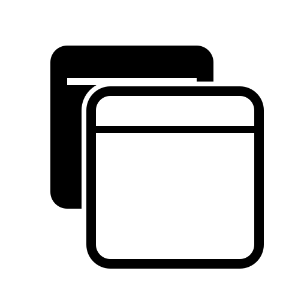

<p align="center">
  
</p>

# Trans

轻量的 Windows 窗口透明度工具。使用 Rust 与原生 Win32 界面开发，单个 `Trans.exe` 即可运行，无需安装，也不依赖 WebView 或 Qt。

拖动准星选窗，搜索并管理多个窗口，分别设置透明度；通过托盘、全局快捷键和窗口列表随时调整与恢复。

**Windows 10 / 11 x64 · 中文 / English · 单文件运行**

[功能](#功能) · [获取与运行](#获取与运行) · [使用指南](#使用指南) · [设置](#设置) · [透明度模式](#透明度模式) · [兼容性与常见问题](#兼容性与常见问题) · [从源码构建](#从源码构建)

## 功能

- **快速选窗**：拖动准星选择窗口，悬停时预览轮廓；可按窗口名称或 PID 模糊搜索，已添加的窗口不再出现在候选中。
- **多窗口管理**：选中即加入列表并分别调整透明度；双击普通模式列表项唤出窗口，可单独恢复或一键恢复全部。
- **灵活调整**：滑块实时生效，五个预设挡位可自定义；主界面底部可单独调整 Trans 自身透明度。
- **两种模式**：默认直接调整原窗口，也可按窗口启用独立透明容器，应对部分应用重新显示窗口后重置透明样式的情况。
- **托盘与快捷键**：默认关闭至托盘，可配置全局恢复快捷键，支持 Esc 返回与关闭。
- **简洁界面**：可显示窗口图标与隐私码，支持中英切换、窗口置顶和列宽调整，紧凑布局适配 DPI 缩放；文字使用 ClearType，自绘圆角和矢量图标优先使用抗锯齿绘制。普通与迷你模式使用紧凑圆角标题栏按钮，并支持 Windows 11 系统窗口圆角，不支持的系统保留原窗口外观。
- **迷你模式**：一键收拢成竖向项目列表，双击已有项目后显示竖向透明度滑块，可从调节页唤出该应用窗口，普通和迷你窗口分别记住大小与位置。

## 获取与运行

运行环境为 **Windows 10 / 11 x64**。可执行文件可从仓库的 [Releases](https://github.com/thaintus/Trans/releases) 页面获取；若暂未提供二进制附件，请按[从源码构建](#从源码构建)自行编译。

1. 将 `Trans.exe` 放到任意目录，双击启动。
2. 需要校验下载文件时，在同一目录执行 `Get-FileHash .\Trans.exe -Algorithm SHA256`，与随版本提供的 `Trans.exe.sha256` 比对。
3. 更新版本时，先从旧版托盘菜单选择“退出”再启动新版。Trans 为单实例程序，旧实例仍在运行时，新进程会唤起已有窗口。

运行只需要 EXE，校验文件不参与运行。设置保存在 `%APPDATA%\Trans\settings.ini`，因此“单文件运行”并不代表配置随 EXE 存放。

配置损坏时，本次运行使用默认设置。后续保存前会先在同目录生成 `settings.recovery-*.ini`，完整保留原文件；无法读取原文件或创建恢复副本时不会覆盖。需要取回旧内容时，先正常退出 Trans，再查看恢复副本。

主窗口在关闭到托盘或正常退出时保存位置与大小，下次启动时恢复；最小化状态下退出会保留最近一次正常窗口的布局，首次启动使用默认大小。普通模式和设置页的最小客户区宽度均为 `305` 逻辑像素，随系统 DPI 缩放。显示器移除、工作区缩小或当前 DPI 下最小尺寸变化时，会自动调整布局以保证标题栏可操作。

## 使用指南

### 选择与调整

1. **选择窗口**：按住左上角准星，拖到目标窗口后松开；或点击搜索框，输入名称或 PID 并从候选中选择。
2. **调整透明度**：拖动主滑块，或点击五个预设按钮；默认挡位为 `0% / 25% / 50% / 75% / 100%`。
3. **管理多个窗口**：重复选窗即可加入更多条目，单击列表项切换当前操作对象。

百分比表示**透明程度**：`0%` 完全不透明，`100%` 完全透明。默认直接模式下，选窗本身不会修改透明度；开启“默认启用独立容器”时，新加入的窗口会自动尝试进入容器模式。

### 窗口列表

列表顶部、“置顶”左侧的眼睛图标控制大号窗口名称的显示与隐藏：睁眼为显示，划线眼睛为隐藏，默认显示并记住上次选择。图标可点击，也可通过 Tab 聚焦后按空格切换，但不影响下拉搜索框、列表中的名称或目标窗口自身的标题。

| 操作 | 效果 |
| --- | --- |
| 单击列表项 | 在上方显示该窗口，并切换透明度控制对象 |
| 双击列表项 | 显示并激活窗口，保留当前透明度与任务栏隐藏设置 |
| 右键 → 启用容器 / 取消容器 | 在两种透明度模式之间切换 |
| 右键 → 置顶 / 取消置顶 | 调整该窗口是否保持在其他普通窗口上方，菜单项随实际状态切换 |
| 右键 → 隐藏 / 取消隐藏 | 隐藏或恢复任务栏运行按钮，窗口仍留在桌面 |
| 右键 → 移除 | 解除管理并移出列表，不关闭目标软件 |
| 恢复当前 / 恢复全部 | 还原原始透明度、解除容器，恢复本工具隐藏的任务栏按钮与修改前的置顶状态，成功后清除对应记录 |

窗口名称后可显示三种状态标记：置顶图钉、独立容器、任务栏按钮已隐藏 `⊘`。仅显示当前生效的状态，不生效时不占位，也不受“展示图标”开关影响；右键菜单的四项操作前同样带有对应图标。列表三列可用表头分隔线调整宽度，总宽度不变，不出现横向滚动条。

置顶与容器切换在后台执行，完成后读取实际状态再更新标记，处理期间会暂时禁用对应菜单项。切换容器模式保留已设置的置顶状态；移除窗口、恢复当前／全部或正常退出时，恢复首次通过菜单修改前的状态。对有外部所属关系、或置顶前已包含独立置顶附属窗口的组合，会拒绝无法独立恢复的操作并说明原因。置顶没有周期性状态维护，原应用自行改动后，再次打开菜单时读取当前状态。

点击列表空白、透明度控制区之外的空白，或切换到其他应用，会取消当前选择，已管理窗口的状态保持不变；透明度标题、滑块、预设和恢复按钮之间的留白保留选择，便于连续操作。

窗口列表只保留本次运行的记录，重启后需要重新选窗；目标程序销毁并重建窗口后，同样需要重新选择。状态标记绘制、置顶同步与容器恢复的细节见[窗口行为与容器机制](docs/window-behavior.md)。

### 迷你模式

点击主界面左下角、齿轮旁的收拢图标进入迷你模式；点击迷你项目列表页底部的展开图标返回完整界面。迷你窗口默认客户区为 `168 × 340` 逻辑像素，默认列出本次运行中已管理的窗口名称与透明度，沿用图标、状态标识及隐私名称。顶部保留准星选窗按钮，按住并拖到目标窗口后即可添加项目并进入调节页；不显示选窗下拉框、刷新按钮、列表标题和空列表说明文字。

单击项目只选中，双击后进入调节页，再上下拖动竖向滑块调整透明度：上拉增加，顶部为 `100%`；下拉降低，底部为 `0%`。调节页顶部改为“打开该应用窗口”按钮，点击可唤出正在调节的窗口，按钮与底部返回按钮同为 `24 × 24` 逻辑像素；需要选择其他新窗口时先返回项目列表使用准星选窗按钮。调节页不显示百分比文字，将空间用于延长滑块；点击底部返回按钮或按 `Esc` 回到项目列表，再从列表页展开完整界面。也可用列表方向键选择项目、按 `Enter` 进入调节页，再用方向键微调滑块。普通界面保持横向滑块和百分比显示。

迷你项目列表页底栏随可用宽度逐步显示控件：最窄时仅显示居中的置顶按钮，拉宽后增加展开按钮，再增加自身透明度横条。横条位于置顶按钮右侧，长度与普通模式相同，不随窗口拉宽而变长；向右增加透明度，拖动实时预览，松开后保存。透明度调节页底部在任何宽度下都只显示居中的返回按钮，不显示置顶按钮或自身透明度横条；中间竖向滑块继续调整目标窗口透明度。隐藏自身透明度横条不会重置已设置的值。

迷你列表自动同步已有窗口的名称、透明度和状态；切换到其他应用时保留当前选择，正在调节的项目关闭或移除后返回列表。完整界面的选窗、预设与设置在展开后恢复；列表页过窄时可先拉宽以显示展开按钮，也可通过托盘菜单“打开”进入普通界面。

迷你项目列表不显示滚动条，项目较多时可用鼠标滚轮上下滚动。在列表中右键窗口，可使用与普通模式相同的独立容器、置顶、任务栏隐藏和移除菜单；右键保持在列表页，不进入调节页。也可用方向键选中项目后按菜单键或 `Shift + F10` 打开菜单，列表空白处不显示窗口菜单。

迷你窗口最小客户区为 `40 × 150` 逻辑像素，按系统 DPI 缩放，标题栏仅保留 `20 × 20` 逻辑像素的紧凑关闭按钮，周围留白可拖动窗口。客户区宽度不足 `100` 或高度不足 `190` 逻辑像素时收起调节页名称行，为滑块留出空间；竖向滑条充分利用顶部打开按钮与底部返回按钮之间的高度。列表较窄时隐藏百分比列，双击项目后仍可调整透明度。极窄时标题栏隐藏图标与标题，左侧留作拖动区域；拉大后相关信息自动恢复，较长名称省略显示。程序记住上次使用的模式，普通与迷你模式分别保存窗口大小和位置；切换界面不改变已管理窗口的透明度、置顶、隐藏或容器状态。

### 快捷键与退出

| 按键或入口 | 行为 |
| --- | --- |
| `Ctrl + Shift + R` | 默认全局快捷键，恢复全部窗口；可在设置中修改或停用 |
| 设置页按 `Esc` | 返回主页面 |
| 迷你调节页按 `Esc` | 返回迷你项目列表 |
| 主页面按 `Esc` 或点击标题栏关闭按钮 | 遵循“关闭至托盘”设置：隐藏到托盘，或恢复窗口后退出 |
| 展开的下拉框、拖动选窗时按 `Esc` | 优先取消当前操作 |
| 设置页“退出 Trans”或托盘菜单“退出” | 恢复窗口后真正退出 |

页面 Esc 仅在 Trans 主窗口处于前台时生效，长按不会连续返回并关闭。若将全局恢复快捷键设为裸 `Esc`，Trans 前台优先执行页面导航，其他应用前台仍执行恢复全部。

托盘右键菜单依次为“打开”“切换”“退出”。“打开”显示普通模式，“切换”在普通与迷你模式之间双向切换，“退出”恢复已管理窗口后退出程序。菜单按当前语言的文本宽度自适应，并按弹出位置所在显示器的缩放比例显示，保留紧凑留白，与窗口列表菜单统一圆角外框、描边、字体和圆角高亮样式。需要设置时，点击普通界面左下角齿轮；需要恢复全部窗口时，可在普通模式点击“恢复全部”，或使用已启用的恢复快捷键。恢复失败时会保留窗口记录与操作入口，便于重试。

## 设置

点击普通界面左下角齿轮进入设置页。配置区域支持滚动，小窗口下也能访问全部选项。

“预设挡位”下方的“关于”模块显示当前版本和项目地址；项目地址以带 `↗` 的蓝色链接显示，点击或聚焦后按回车，可通过默认浏览器打开。

| 配置项 | 默认值 | 说明 |
| --- | --- | --- |
| 语言 | 中文 | 切换中文 / English，即时更新界面并保存 |
| 默认启用独立容器 | 关闭 | 仅影响之后新加入的窗口，不修改已有条目 |
| 关闭至托盘 | 开启 | 关闭主窗口后继续管理已选窗口 |
| 展示图标 | 关闭 | 在窗口列表的名称前显示应用图标 |
| 隐私模式 | 关闭 | 仅将列表名称替换为七位随机字母数字码；搜索框与上方名称仍显示真实标题 |
| 恢复全部快捷键 | `Ctrl + Shift + R` | 支持 Ctrl、Alt、Shift 修饰键，可停用；编辑后点击“保存” |
| 预设挡位 1–5 | `0 / 25 / 50 / 75 / 100` | 每项为 `0` 到 `100` 的整数，允许重复和任意顺序；编辑后点击“保存” |

语言与配置开关即时保存，快捷键和挡位分别通过所属区域的“保存”生效；更改预设值不会立即改变目标窗口的透明度。隐私模式不隐藏窗口内容，也不修改目标应用的真实标题。

主界面右下角滑块控制 **Trans 自身的透明度（0%–80%）**，调整完成后保存；窗口名称右侧的图钉按钮控制 Trans 是否保持在其他窗口上方。蓝色实心图钉表示已置顶，灰色空心图钉表示未置顶，按钮背景不随置顶状态填色；移开鼠标或点击空白处后仍保持状态标识，悬停提示会显示当前状态及点击后的操作。迷你列表页的图钉按钮使用相同规则。

## 透明度模式

| | 直接模式（默认） | 独立容器（实验性） |
| --- | --- | --- |
| 作用对象 | 原应用窗口 | 通常嵌入宿主；带原生菜单或部分 GPU 窗口自动使用顶层联动方式 |
| 使用场景 | 常规窗口透明度调整 | 原应用会自行清除透明样式时，可尝试此模式 |
| 状态维护 | 窗口事件触发恢复，并在事件后短时补检 | 由窗口事件和用户操作同步外框与内容，无短时补检 |
| 窗口外观 | 保留原窗口结构 | 共用浅色平面标题栏与细边框，保留原应用标题区 |
| 移动与缩放 | 使用原窗口 | 拖动外层标题栏移动，沿外层窗口边缘缩放 |

两种模式都没有常驻的每秒全窗口扫描。直接模式的补检只在相关事件后短暂运行，异步恢复仍可能出现短暂的不透明画面，无法保证拦截应用首次绘制。

容器沿用目标软件图标，在任务栏中与 Trans 主窗口分组区分；宿主客户区始终透明留空，避免叠加原窗口的透明度。取消容器时，原窗口恢复到进入容器前的结构与位置，再按当前透明度切回直接模式。顶层联动方式请优先使用最外层标题栏和按钮移动、最大化与还原；原应用自己的最大化按钮会转为最大化外框，还原使用外层按钮。

**独立容器目前仅接受原始不透明的窗口。** 跨进程嵌入可能影响应用自身的弹窗、输入法、快捷键、全屏、DPI 与多显示器行为，需要按应用验证兼容性。容器关闭按钮向原应用发送正常关闭请求，最终退出还是收至托盘由原应用决定。

使用容器后，请通过“取消容器”“移除”或正常退出 Trans 解除嵌入；强制结束 Trans 可能导致嵌入窗口随宿主关闭，无法保证恢复原状态。两种托管方式的外观、恢复顺序与机制细节见[窗口行为与容器机制](docs/window-behavior.md)。

## 兼容性与常见问题

- **无法调整某个窗口**：Trans 默认以当前用户权限运行。若目标应用以管理员身份运行，请先恢复已管理窗口并退出 Trans，再以管理员身份重新运行。特殊逐像素分层窗口，或无法可靠读取原始状态的窗口，会被拒绝调整。
- **切回应用后透明度失效**：部分软件会重建窗口或重置透明样式。直接模式依靠窗口活动事件及短时补检恢复，静默重置且没有后续事件时可能暂时失效，可尝试独立容器。窗口重建后需要重新选窗。
- **任务栏仍有图标**：隐藏功能针对运行中的窗口按钮，不取消固定快捷方式；非标准任务栏窗口可能不支持，应用也可能自行重建按钮。
- **窗口调到 100% 后找不到了**：可用已启用的恢复快捷键（默认为 `Ctrl + Shift + R`），或通过托盘菜单“打开”进入普通模式，再点击“恢复全部”。完全透明的窗口仍可能接收输入。
- **退出后未恢复**：正常退出会尝试恢复，失败时保留记录；崩溃、强制结束进程或异常断电无法保证恢复，必要时重新启动目标应用。

## 从源码构建

### 环境要求

- Windows x64。
- Rust MSVC 工具链与 Cargo；`Cargo.toml` 声明的最低 Rust 版本为 **1.82**。
- Visual Studio C++ Build Tools，包含 MSVC 编译工具和 Windows SDK（提供 `rc.exe`）。

在仓库根目录执行以下 PowerShell 命令：

```powershell
powershell -NoProfile -ExecutionPolicy Bypass -File .\scripts\build-release.ps1
```

打包脚本默认自动将补丁版本号加一，也可使用 `-Version 2.1.0` 显式指定高于当前版本的稳定版本号。源码、关于页及 EXE 文件属性中的版本保持同步。打包成功后保留新版本，构建或发布失败时恢复原版本。

脚本默认使用已缓存的锁定依赖离线构建 Windows x64 Release 版本，核对 x64 GUI 格式和源文件、发布文件的 SHA256，每次生成独立目录：

```text
dist/
└── release-yyyyMMdd-HHmmss/
    ├── Trans.exe
    └── Trans.exe.sha256
```

旧发布目录会保留；新目录重名时脚本停止，避免覆盖已有文件。脚本不安装编译环境，也不自动启动程序或运行测试。

首次构建或本地缺少依赖时，可显式允许 Cargo 联网获取依赖：

```powershell
powershell -NoProfile -ExecutionPolicy Bypass -File .\scripts\build-release.ps1 -AllowOnline
```

`dist/` 与 `target/` 由 Git 忽略；分发时请将 EXE 和校验文件作为 GitHub Release 附件上传。

也可直接使用 Cargo，仅生成编译产物：

```powershell
cargo build --release --locked --target x86_64-pc-windows-msvc
```

默认产物位于 `target\x86_64-pc-windows-msvc\release\Trans.exe`。首次构建需要获取锁定依赖；依赖已缓存时，可添加 `--offline` 离线构建。

项目使用 Rust 2021、`windows-sys`、Win32 原生控件及 GDI / GDI+ 绘制，通过 `.cargo/config.toml` 静态链接 CRT。图标、manifest 与相关资源声明嵌入 EXE，分发时无需携带 `assets/`。如果无法找到资源编译器，可设置环境变量 `RC` 为 Windows SDK `rc.exe` 的完整路径。

### 代码导览

| 路径 | 职责 |
| --- | --- |
| [src/app.rs](src/app.rs) | 主窗口、消息分发、选窗、列表与页面交互 |
| [src/mini_list.rs](src/mini_list.rs) | 迷你项目列表、增量更新与列表位置恢复 |
| [src/window_control.rs](src/window_control.rs) | 窗口身份、透明度快照与恢复 |
| [src/window_events.rs](src/window_events.rs) | 窗口事件与直接模式短时补检 |
| [src/window_container.rs](src/window_container.rs) | 独立宿主、嵌入、状态同步与脱离 |
| [src/container_frame.rs](src/container_frame.rs)、[src/container_input.rs](src/container_input.rs) | 容器标题栏与边距、原窗口输入转发 |
| [src/window_topmost.rs](src/window_topmost.rs) | 置顶状态读取与后台请求 |
| [src/picker_overlay.rs](src/picker_overlay.rs)、[src/window_search.rs](src/window_search.rs) | 拖动选窗覆盖层与窗口搜索过滤 |
| [src/presentation.rs](src/presentation.rs)、[src/list_scrollbar.rs](src/list_scrollbar.rs) | 列表呈现数据、隐私码与列表滚动条 |
| [src/ui_theme.rs](src/ui_theme.rs)、[src/compact_menu.rs](src/compact_menu.rs) | 控件主题、抗锯齿图形与紧凑菜单 |
| [src/settings.rs](src/settings.rs)、[src/settings_panel.rs](src/settings_panel.rs) | 配置存储与设置页布局 |
| [src/hotkey.rs](src/hotkey.rs) | 快捷键解析、校验与格式化 |
| [src/localization.rs](src/localization.rs) | 中文 / English 本地化 |
| [src/taskbar.rs](src/taskbar.rs)、[src/tray.rs](src/tray.rs) | 任务栏与托盘集成 |
| [assets/](assets/) | 应用图标、manifest 与图标授权声明 |
| [scripts/build-release.ps1](scripts/build-release.ps1) | Release 打包与哈希核对 |

## 问题反馈

可通过 [Issues](https://github.com/thaintus/Trans/issues) 提交问题。为便于复现，请附上：

- Trans 版本或 EXE 的 SHA256、Windows 版本及显示缩放比例。
- 目标应用名称与版本，是否以管理员身份运行。
- 使用直接模式还是独立容器，以及具体操作步骤、预期效果和实际表现。
- 如有必要，附不包含敏感内容的截图或录屏。

开发过程、版本变更及验证范围见独立的[开发与验证记录](docs/validation-history.md)。

## 图标与许可

本项目采用 [MIT License](LICENSE)，版权归属为 `Copyright (c) 2026 thaintus`。第三方素材保留各自的许可声明。

应用图标源文件为 [assets/trans.svg](assets/trans.svg)。选窗和刷新图标分别采用 Lucide 的 `focus` 与 `rotate-cw` 形状，相关 ISC 授权声明保存在：

- [lucide-focus-LICENSE.txt](assets/lucide-focus-LICENSE.txt)
- [lucide-rotate-cw-LICENSE.txt](assets/lucide-rotate-cw-LICENSE.txt)
